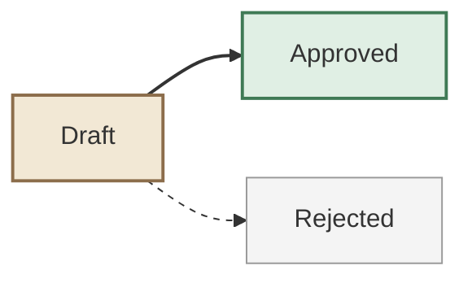

# Flowchart styling

One renderable example for `style`, `classDef`, and `linkStyle` as summarized in
[styling and configuration](../styling.md#styling-individual-elements). Fictional content;
colors are illustrative, not a contrast guarantee.

