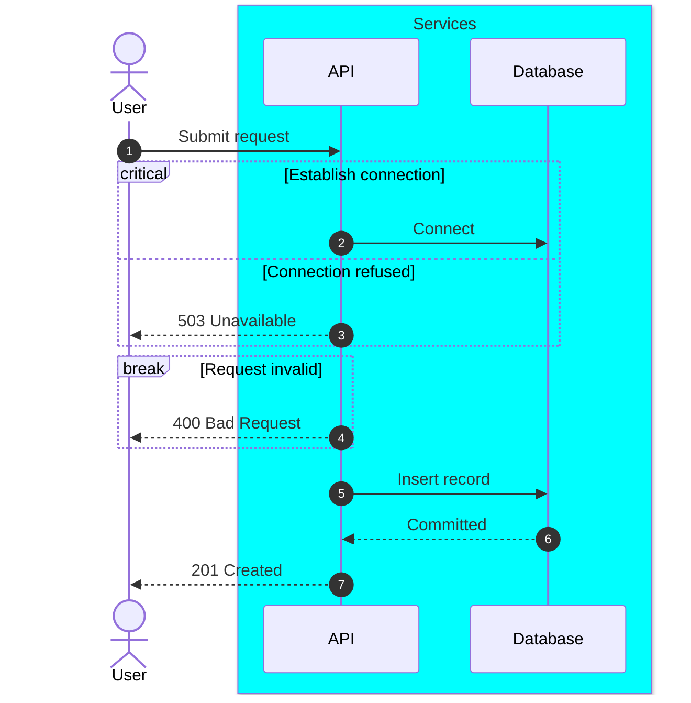

# Sequence grouping, menus, and critical regions

One renderable example for the participant box, actor menu, `critical`/`option`, and
`break` constructs summarized in [syntax essentials](../syntax.md#sequence). Fictional
content; the URLs are illustrative and not fetched during rendering.

Rendering note: in a narrow diagram the block keyword label sits at the left edge and can be
clipped by the block border (`reak`, `ritical`). Widen the diagram, shorten the block title,
or add participant spacing before publishing; a successful parse does not catch this.

