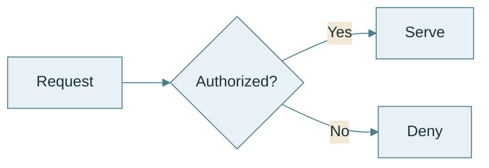

# Theme and layout configuration

One renderable example for frontmatter configuration and the preference for `base` when
overriding `themeVariables`, as summarized in
[styling and configuration](../styling.md#themes-and-looks). Fictional content; colors are
illustrative.

